

### Terror com humor em um maid café abandonado

Sobreviva das **00:00 às 06:00** vigiando as câmeras de um café cujas garçonetes androides
ainda acham que é a noite da inauguração, e que você é o cliente mais especial de todos.

---

  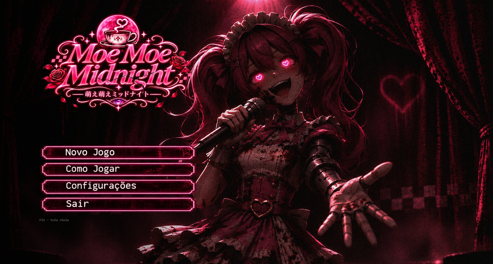

> **Projeto de portfólio.** Este repositório mostra o jogo: artes, telas e o que foi feito.
> O código-fonte não está aqui.

  

## Sumário

- [Jogar no Android](#jogar-no-android)
- [A história](#a-história)
- [Telas do jogo](#telas-do-jogo)
- [As androides](#as-androides)
- [Como se joga](#como-se-joga)
- [O que eu fiz](#o-que-eu-fiz)
- [Galeria](#galeria)
- [Créditos](#créditos)

## Jogar no Android

1. No celular, baixe `MoeMoeMidnight-v1.0.0-android.apk` em [**Releases**](https://github.com/Maidzinha/moe-moe-midnight-portfolio/releases/latest).
2. Toque no arquivo e permita **"Instalar apps desconhecidos"** quando o Android pedir.
3. Abra o jogo: ele roda deitado, em tela cheia. Toque no lado da tela para olhar para aquele lado.

Precisa de Android 6 ou mais novo. O jogo é gratuito.

## A história

O **Moe Moe Midnight** seria o primeiro café do país atendido só por androides maids. Na noite da
inauguração, um curto-circuito durante o show de abertura causou um incêndio. O dono fugiu das dívidas,
o prédio foi lacrado e as androides ficaram lá dentro. Desligadas... em teoria.

Anos depois, uma empresa de reformas contrata você como **segurança noturno**. Toda noite, o
**Dr. Ernesto**, o cientista excêntrico que construiu as androides, deixa uma mensagem no telefone
com dicas meio inúteis e, aos poucos, a verdade sobre o incêndio. Seis noites depois, o café revela
quem estava esperando lá embaixo esse tempo todo.

## Telas do jogo

  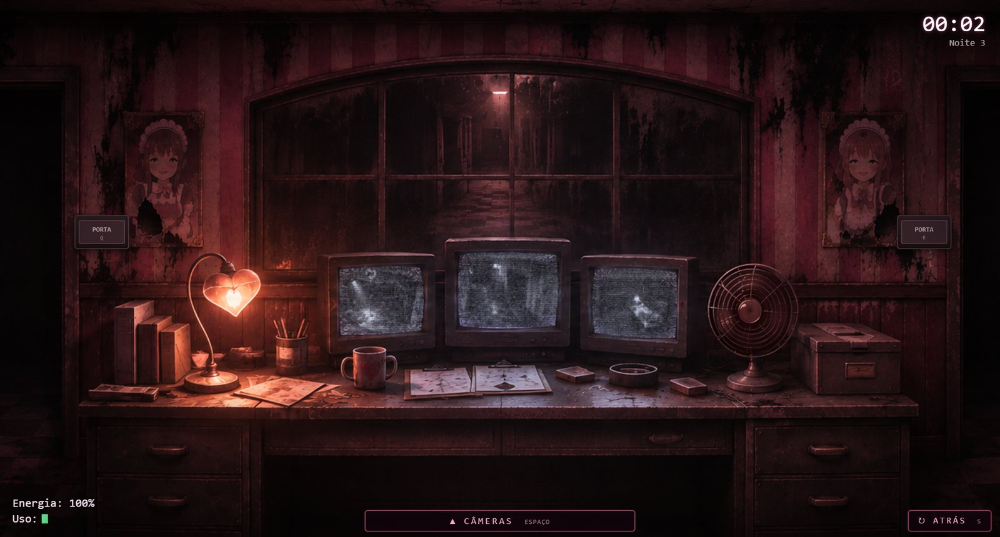
   A sala de segurança: portas laterais, tablet de câmeras e a energia sempre acabando.

  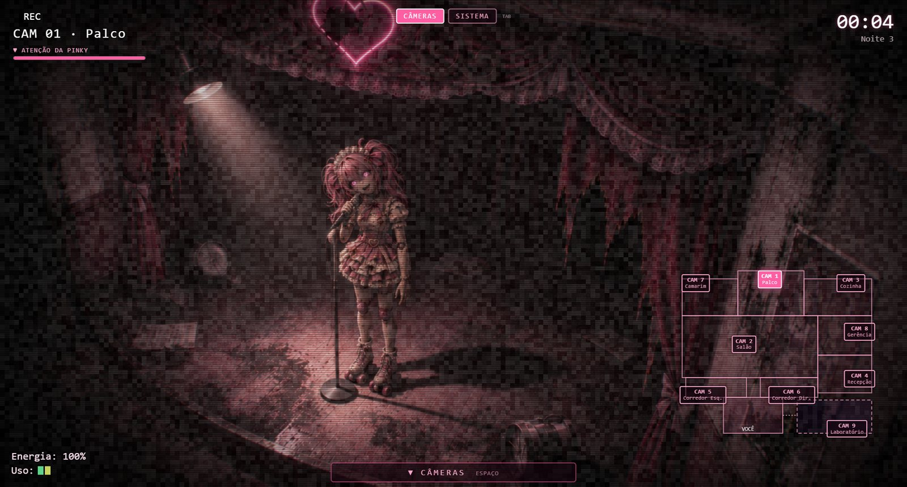
  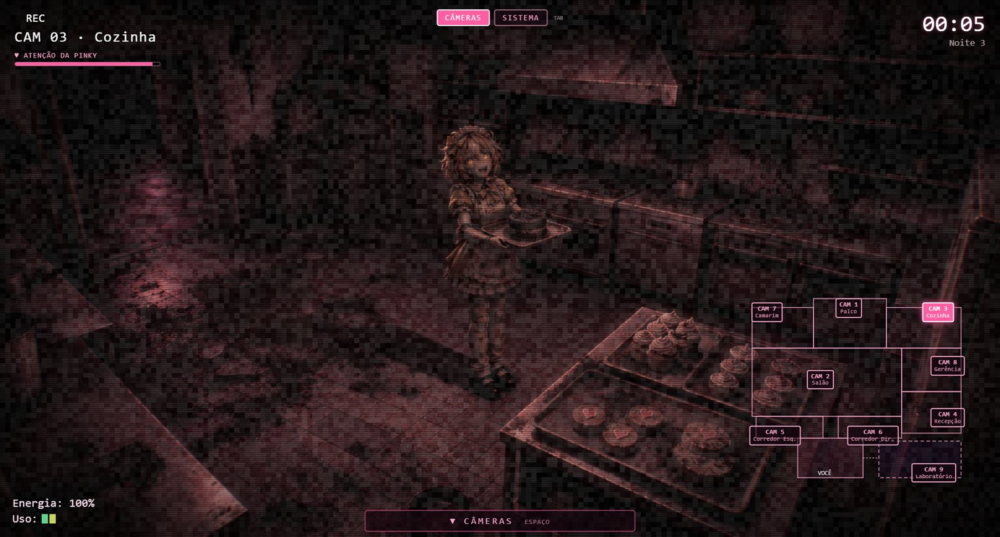
   
  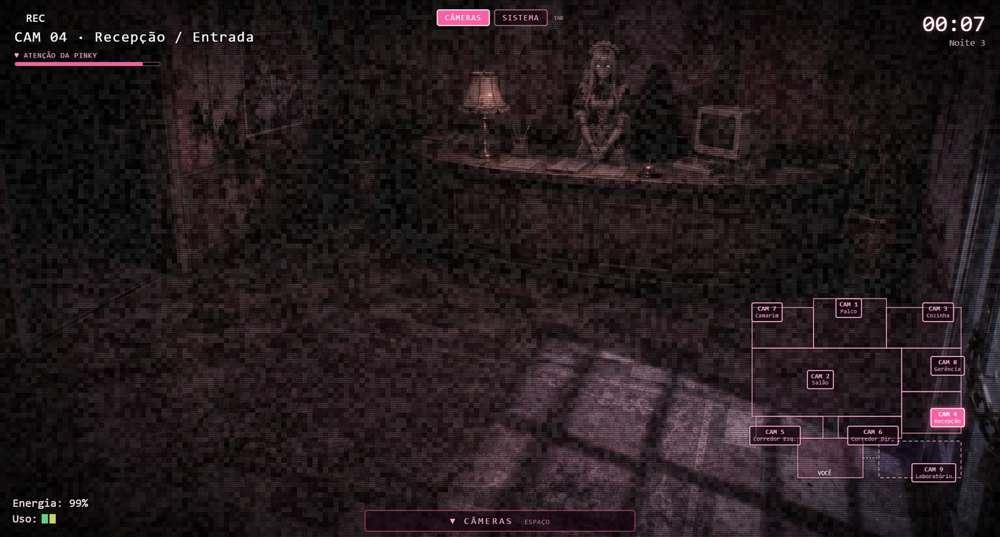
  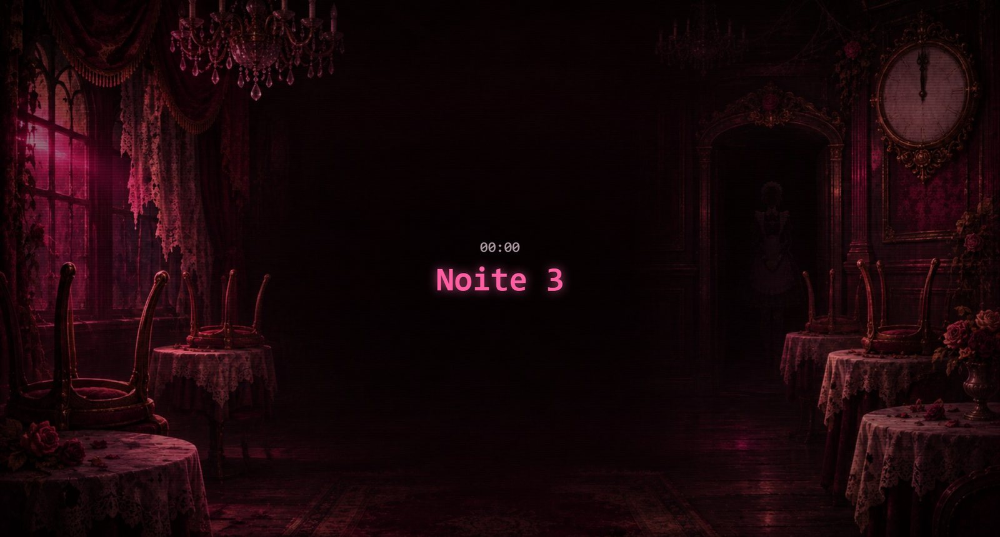
   Nove câmeras com estática, falhas de sinal e mapa interativo.

## As androides

  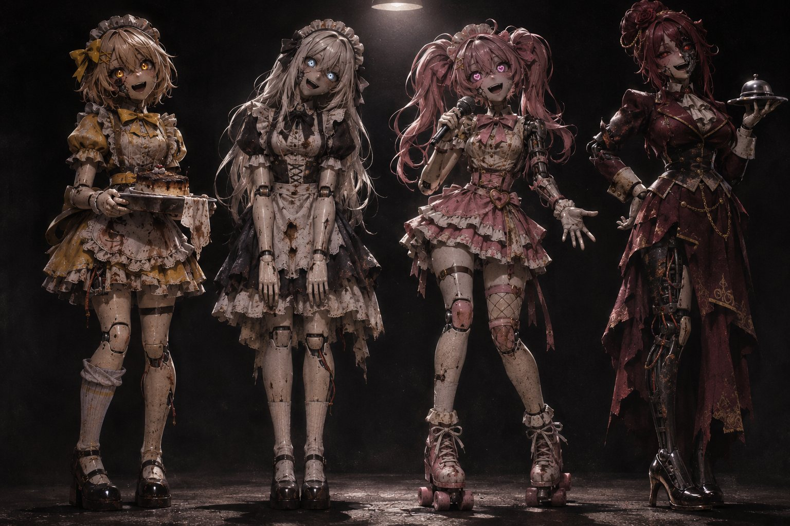

| | Personagem | O que ela faz | Como sobreviver |
|:-:|---|---|---|
| ☕ | **Hikari**, a garçonete estabanada | Manda pedidos pelo tablet; ignorados, ela vem entregar pessoalmente | Atender os pedidos a tempo |
| 🌙 | **Lily**, a recepcionista | Só se move quando ninguém está olhando a câmera dela | Vigiar pelas câmeras |
| 🎤 | **Pinky**, a idol do café | Precisa de plateia; sem atenção, dispara de patins pelos corredores | Olhar o palco de vez em quando |
| 🌹 | **Madame Rose**, a gerente | Corta câmeras e portas e faz inspeções surpresa | Religar sistemas e não mexer em nada na inspeção |
| ❔ | **???** | Alguém sobe do porão quando ninguém está olhando | Descubra jogando |

## Como se joga

- **6 noites**, de 00:00 às 06:00, cada uma com cerca de 8 minutos
- **Energia limitada:** portas fechadas e tablet aberto gastam mais; se acabar, apagão
- **Dificuldade crescente:** cada androide fica mais agressiva **a cada hora e a cada noite**
- **Cada maid exige uma atenção diferente:** atender pedidos, vigiar, dar plateia, não mexer em nada
- A **sexta noite** muda as regras e leva ao **final verdadeiro**

## O que eu fiz

Da ideia ao lançamento da versão 1.0.0.

**Design e narrativa**
- História, personagens e a "bíblia" do universo do café
- Roteiro das ligações do Dr. Ernesto, das falas das maids e das cutscenes entre as noites
- Mecânicas próprias para cada androide e a curva de dificuldade das seis noites

**Programação** (HTML, CSS e JavaScript puro, empacotado com Electron)
- IA das androides com movimento por salas, comportamentos próprios e dificuldade por hora e por noite
- Sistema de câmeras com estática gerada em canvas, falhas de sinal e mapa clicável
- Energia, portas, apagão, jumpscares por personagem e a transição das 06:00
- Ligações com legenda sincronizada ao áudio, configurações de volume e salvamento automático
- **Simulador de balanceamento:** robôs com três níveis de habilidade jogam centenas de noites
  para medir a taxa de vitória de cada noite antes de qualquer teste humano

**Arte e som**
- Direção de arte de todas as telas, personagens, salas e fichas técnicas
- Vozes das maids e das ligações produzidas com ElevenLabs, com filtro robótico
- Efeitos sonoros originais de câmera e de menu gerados por código

## Galeria

  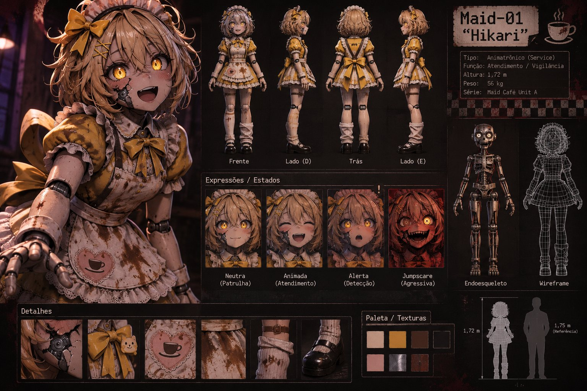
  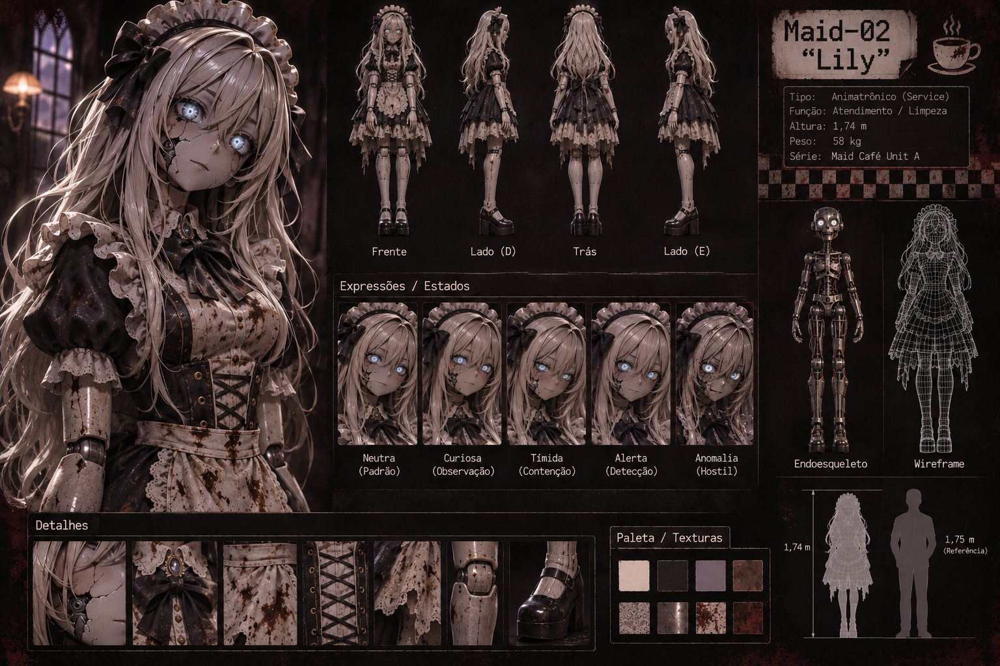
   
  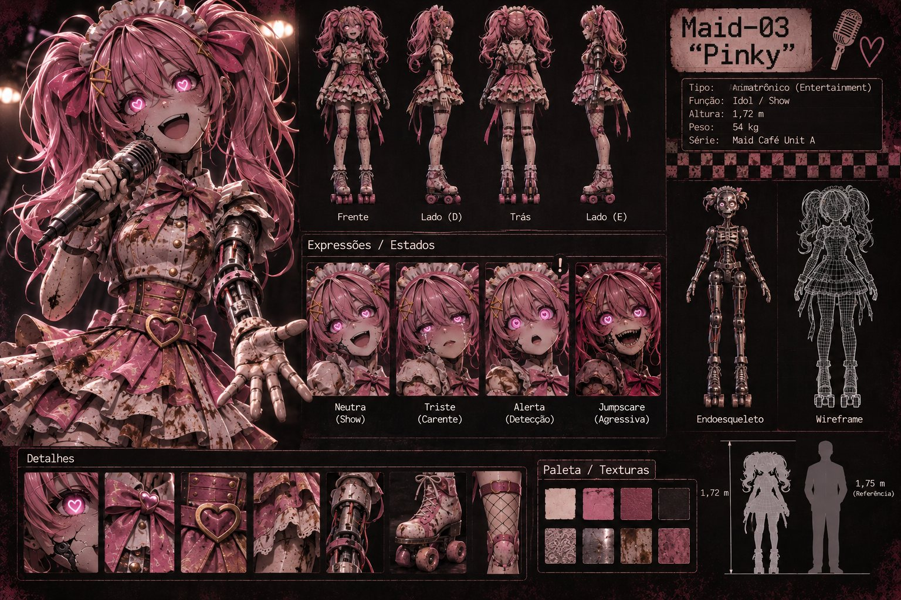
  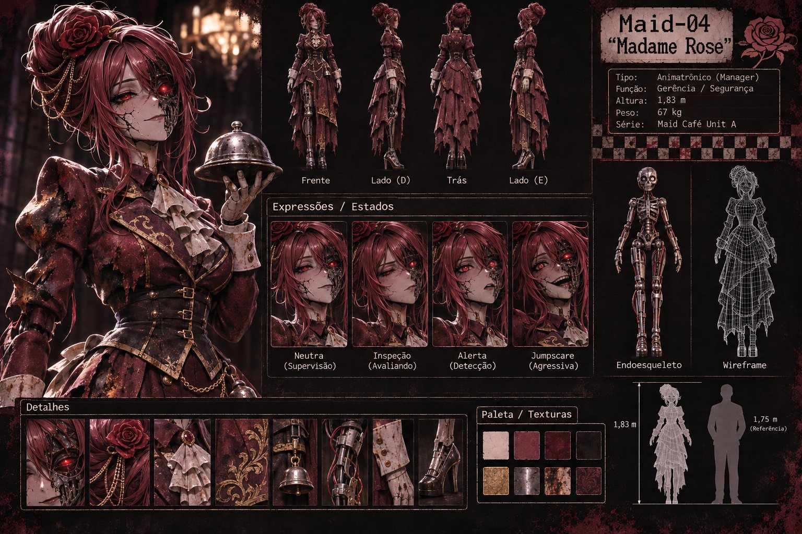
   Fichas técnicas das androides.

  
  
  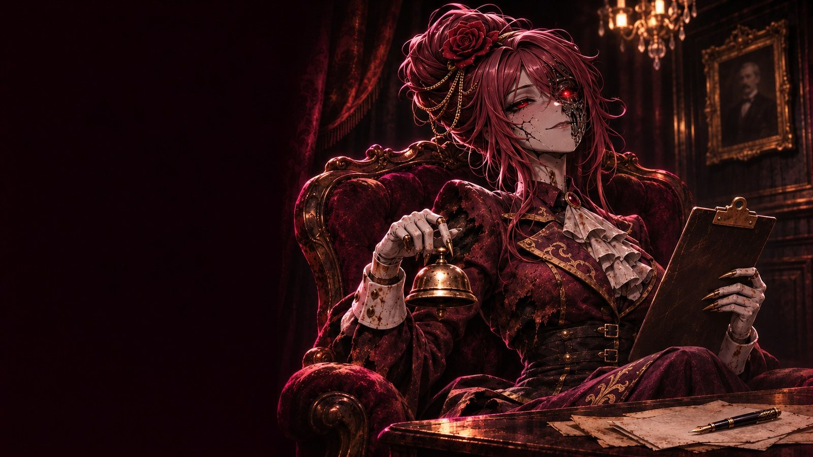
   A tela inicial sorteia uma androide a cada vez que o jogo abre (e guarda uma surpresa para quem chega ao final).

  
   Um dos jumpscares, um para cada androide.

## Créditos

  

- Criação, design, roteiro e programação: **Maidzinha Interactive Creations**
- Artes geradas com IA a partir de direção de arte original
- Vozes: ElevenLabs
- Música ambiente e alguns efeitos: autores do [Freesound](https://freesound.org) (CC BY 4.0 / CC0), creditados dentro do jogo

---

© 2026 Maidzinha Interactive Creations · Todos os direitos reservados. 
As imagens deste repositório não podem ser reutilizadas sem autorização.

